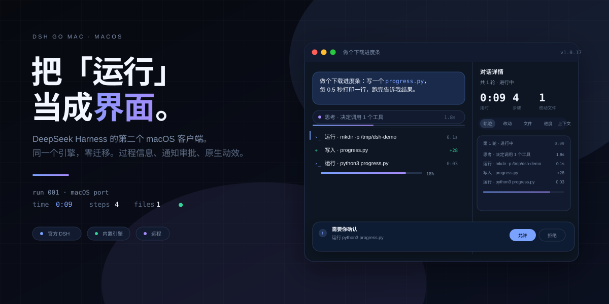
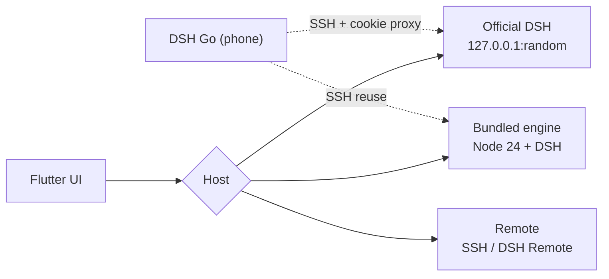

<div align="center">

<a href="https://billwgong.github.io/dsh-go-mac/"></a>

<p><a href="https://github.com/BillWGong/dsh-go-mac/releases/latest"><b>Download</b></a> · <a href="https://github.com/BillWGong/homebrew-tap">Homebrew</a> · <a href="https://www.bilibili.com/video/BV1njxJ6WE59/">Demo</a> · <a href="https://billwgong.github.io/dsh-go-mac/">Site</a> · <a href="README.md">简体中文</a></p>

<p><sub>macOS 12+ · Apple Silicon · AGPL-3.0</sub></p>

<p><sub>The hero version and star count refresh daily via CI.</sub></p>

</div>

> [!NOTE]
> Unofficial community project, not affiliated with DeepSeek. The UI comes from [ccch1mneyyy/dsh-go](https://github.com/ccch1mneyyy/dsh-go) (AGPL-3.0); the platform layer is written in Swift. See [NOTICE](NOTICE).

---

## 01 · Ten seconds, no speed-up

<p align="center"></p>

<p align="center"><sub>A real recording. One tool-using task, from thinking to run details.</sub></p>

## 02 · Where are you coming from?

<details open>
<summary><b>I already use the official DSH</b> — I just want a better surface</summary>

No runtime, no migration. On first launch pick “Connect to official DSH”; it reads the same `~/.dsh`.

```bash
brew install --cask BillWGong/tap/dsh-go-mac
```

</details>

<details>
<summary><b>I want the Mac to run it</b> — no official client needed</summary>

Install the bundled runtime (~750 MB) and DSH runs on this Mac. Switch back any time.

```bash
brew install --cask BillWGong/tap/dsh-go-mac
# On first launch pick “This Mac”, then install the runtime
```

</details>

<details>
<summary><b>I want to attach remotely</b> — SSH / DSH Remote</summary>

The same UI against DSH on another machine. The Android DSH Go can also drive this Mac.

```text
Settings › Switch host › Remote host
```

</details>

## 03 · The run is the interface

<p align="center"></p>

A turn ends; three numbers come first: **time, steps, changed files**. Below them, five tabs: **trace / diff / files / progress / context**.

Diff opens the patch; trace replays every step; each thought and tool call gets its own row with its own timing. Approvals and questions rise out of the stream instead of hiding below message forty.

## 04 · Same engine, no migration


On first launch it finds a running DeepSeek Harness. Pick “Connect to official DSH”:

- Chats, models and plugins are already there; **nothing is copied or migrated**
- It reads the same `~/.dsh`; the official client keeps working
- Or switch to the bundled engine, or a remote host over SSH / DSH Remote

The two engines keep separate data. Switching never mixes them, and never rewrites the other.

## 05 · Native

Flutter for the UI, Swift for the platform, native Node for the engine.

No Electron, no embedded browser. Notifications, files, PDF, speech, the pet, windows and deep links all go through macOS APIs. The “Allow / Deny” on a notification is a real system notification, not a button in a web page.

## 06 · What it isn't

- **Not a new engine.** It's another client for DSH.
- **Not a replacement for the official app.** When attached, both can run side by side.
- **Not a web wrapper.** No embedded browser.
- **Not for Intel.** The runtime is arm64 only.
- **Not finished.** Mac control, in-app updates and signing are still missing.

## 07 · Install

```bash
# One command
brew install --cask BillWGong/tap/dsh-go-mac

# Or the DMG (Apple Silicon / macOS 12+)
open https://github.com/BillWGong/dsh-go-mac/releases/latest
open "/Applications/DSH Go Mac.app"

# If Gatekeeper blocks the unsigned build
xattr -dr com.apple.quarantine "/Applications/DSH Go Mac.app"
```

## 08 · Where it is

| | |
| :--- | :--- |
| ✅ Daily-driver ready | Bundled engine, official attach, remote, notification approvals, files/PDF/speech, pet, phone link, share card |
| 🚧 Not yet | Mac control ([design](docs/macos/mac-control.md)), in-app updates, signing/notarization |
| ❌ Not planned | Intel Mac, Windows |

---

<details>
<summary><b>How it's built</b></summary>



- **Bundled engine** — Node 24 + DSH + pnpm + bridge, a 193 MB tar with a manifest; unpacks into Application Support, runs `node bin.js web --port <free>`, token from stdout, supervised with safe mode.
- **Official attach** — `lsof` finds the port, the browser-session secret is read from `~/.dsh`, a HMAC cookie is minted locally; official data is never written.
- **Phone proxy** — a loopback reverse proxy: the phone gets a local cookie, HTTP/WebSocket is forwarded with the official cookie injected and Host rewritten.
</details>

<details>
<summary><b>Development & tests</b></summary>

```bash
git clone https://github.com/BillWGong/dsh-go-mac.git
cd dsh-go-mac
bash runtime/build-runtime-macos.sh   # bundled runtime
bash tooling/build-macos.sh --dmg     # .app + DMG

cd app
flutter analyze
flutter test test/macos
flutter test test/chat test/state
```

Full Xcode, Flutter 3.47.x, Apple Silicon, ~8 GB free disk. Environment check: `bash tooling/check-macos-env.sh`.
</details>

<details>
<summary><b>Questions</b></summary>

**How is this related to the official client?** Another client for the same engine. When attached, chats, models and plugins are shared; no data migration.

**Why 255 MB, and another 750 MB?** The app ships a 193 MB compressed Node + DSH runtime. The first bundled-engine run unpacks it. Official-only use skips it entirely.

**Unsigned / won't open?** Right-click → Open, or `xattr -dr com.apple.quarantine "/Applications/DSH Go Mac.app"`.

**Saving an SSH host fails?** Since 1.0.16, remote secrets use a 0600 file (ad-hoc signing has no Keychain entitlement) at `~/Library/Application Support/io.github.billwgong.dshgomac/remote-secrets.json`.

**Where did “delete conversation” go?** It needs the bundled runtime `macos-r2`. Existing installs should reinstall the runtime from `Settings › Local engine` (keep conversations when prompted). Official mode does not support deletion.
</details>

---

## License

AGPL-3.0. Built on [ccch1mneyyy/dsh-go](https://github.com/ccch1mneyyy/dsh-go); the engine is [DeepSeek Harness](https://github.com/deepseek-ai/deepseek-harness). Brand attribution in [NOTICE](NOTICE) and [ASSETS.md](ASSETS.md).

<div align="center">

**If it saves you from scrolling through chat logs, a star is enough ⭐**

[](https://github.com/BillWGong/dsh-go-mac)

</div>
