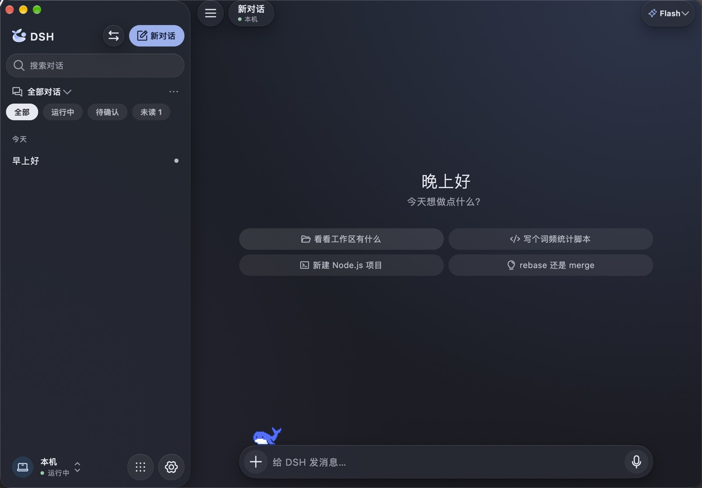
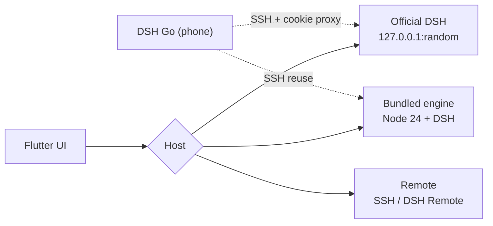

<div align="center">

<p><sub>DSH GO MAC · macOS</sub></p>

<h3>Treat the run as the interface.</h3>

<p>The second macOS client for DeepSeek Harness.<br/>
Same engine. It just lets you see the work.</p>

<p><a href="https://github.com/BillWGong/dsh-go-mac/releases/latest"><b>Download</b></a> · <a href="https://www.bilibili.com/video/BV1njxJ6WE59/">Demo video</a> · <a href="README.md">简体中文</a></p>

<p><sub>macOS 12+ · Apple Silicon · AGPL-3.0 · v1.0.17</sub></p>

</div>

```text
run 001 · macOS port
────────────────────────────────────────────────────────
time  2:01:57        steps  122        files  1
trace   diff   files   progress   context
```

That isn't decoration. It's a real long run from the app — time, steps, changed files, and the five tabs.



> [!NOTE]
> Unofficial community project, not affiliated with DeepSeek. The UI comes from [ccch1mneyyy/dsh-go](https://github.com/ccch1mneyyy/dsh-go) (AGPL-3.0); the platform layer is written in Swift. See [NOTICE](NOTICE).

---

## 00 · The problem

Chat is good at reading, bad at seeing.

When a run takes forty minutes, the last message isn't what you need. You need to know what it's doing now, why the last step was slow, which files changed, and which approval it's stuck on. That information is scattered through the transcript — scroll up, open things, reconstruct it.

Most clients fold the run into the chat log. We pull it out and put it where you can see it.

## 01 · The idea

<p align="center"></p>

**The run is a first-class object. Chat is just the entrance.**

- A turn ends; three numbers come first: time, steps, changed files
- Five tabs: trace, diff, files, progress, context
- Diff opens the patch; trace replays every step
- Each thought and tool call gets its own row, with its own timing
- Approvals and questions rise out of the stream instead of hiding below message forty

Even the motion serves this: a breathing thinking pill, tool rows sliding in, continuous folds. Not decoration — how you read a long run at a glance.

## 02 · The engine


**The same engine. No migration.**

On first launch it finds a running DeepSeek Harness. Pick “Connect to official DSH” and:

- Your chats, models and plugins are already there; nothing is copied or migrated
- It reads the same `~/.dsh`; the official client keeps working
- You can switch to the bundled engine, or to a remote host over SSH / DSH Remote

The two engines keep separate data. Switching never mixes them, and never rewrites the other.

## 03 · Native

Flutter for the UI, Swift for the platform, native Node for the engine.

No Electron, no embedded browser. Notifications, files, PDF, speech, the desktop pet, windows and deep links all go through macOS APIs.

That's why it's a client rather than a wrapper: the window, the allow/deny on a notification, the floating pet — they're real system objects.

## 04 · What it isn't

- **Not a new engine.** It's another client for DSH.
- **Not a replacement for the official app.** When attached, both can run side by side.
- **Not a web wrapper.** No embedded browser.
- **Not for Intel.** The runtime is arm64 only.
- **Not finished.** Mac control, in-app updates and signing are still missing — see the status below.

## 05 · Install

```bash
# 1. Download (Apple Silicon / macOS 12+)
open https://github.com/BillWGong/dsh-go-mac/releases/latest

# 2. Drag it into Applications, then open it
open "/Applications/DSH Go Mac.app"

# 3. If Gatekeeper blocks the unsigned build
xattr -dr com.apple.quarantine "/Applications/DSH Go Mac.app"
```

First launch:

- **Already using the official DSH?** Pick “Connect to official DSH” — no runtime install
- **Want the bundled engine?** Pick “This Mac” and install the ~750 MB runtime
- **Remote?** Pick “Remote host”

## 06 · The phone

The Android DSH Go can take over the Mac:

1. On the Mac, enable `System Settings › General › Sharing › Remote Login`
2. In the app, open `Settings › Local engine › Phone link` — host, port and the password note are right there
3. In DSH Go on the phone: `Switch host › Add SSH host`, keep the default `dsh web` command
4. The password is **your Mac login password**, not a DeepSeek key

In official mode the phone attaches to the same official DSH through a local cookie-injecting proxy (HTTP + WebSocket).

## 07 · Where it is

| | |
| :--- | :--- |
| ✅ Daily-driver ready | Bundled engine, official attach, remote, notification approvals, files/PDF/speech, pet, phone link, share card |
| 🚧 Not yet | Mac control ([design](docs/macos/mac-control.md)), in-app updates, signing/notarization |
| ❌ Not planned | Intel Mac, Windows |

---

<details>
<summary><b>How it's built</b></summary>



- **Bundled engine** — Node 24 + DSH + pnpm + bridge, a 193 MB tar with a manifest; unpacks into Application Support, runs `node bin.js web --port <free>`, token from stdout, supervised with safe mode.
- **Official attach** — `lsof` finds the port, the browser-session secret is read from `~/.dsh`, a HMAC cookie is minted locally; official data is never written.
- **Phone proxy** — a loopback reverse proxy: the phone gets a local cookie, HTTP/WebSocket is forwarded with the official cookie injected and Host rewritten.
</details>

<details>
<summary><b>Development & tests</b></summary>

```bash
git clone https://github.com/BillWGong/dsh-go-mac.git
cd dsh-go-mac
bash runtime/build-runtime-macos.sh   # bundled runtime
bash tooling/build-macos.sh --dmg     # .app + DMG

cd app
flutter analyze
flutter test test/macos
flutter test test/chat test/state
```

Full Xcode, Flutter 3.47.x, Apple Silicon, ~8 GB free disk. Environment check: `bash tooling/check-macos-env.sh`.
</details>

<details>
<summary><b>Questions</b></summary>

**How is this related to the official client?** Another client for the same engine. When attached, chats, models and plugins are shared; no data migration.

**Why 255 MB, and another 750 MB?** The app ships a 193 MB compressed Node + DSH runtime. The first bundled-engine run unpacks it. Official-only use skips it entirely.

**Unsigned / won't open?** Right-click → Open, or `xattr -dr com.apple.quarantine "/Applications/DSH Go Mac.app"`.

**Saving an SSH host fails?** Since 1.0.16, remote secrets use a 0600 file (ad-hoc signing has no Keychain entitlement) at `~/Library/Application Support/io.github.billwgong.dshgomac/remote-secrets.json`.

**Where did “delete conversation” go?** It needs the bundled runtime `macos-r2`. Existing installs should reinstall the runtime from `Settings › Local engine` (keep conversations when prompted). Official mode does not support deletion.
</details>

---

## License

AGPL-3.0. Built on [ccch1mneyyy/dsh-go](https://github.com/ccch1mneyyy/dsh-go); the engine is [DeepSeek Harness](https://github.com/deepseek-ai/deepseek-harness). Brand attribution in [NOTICE](NOTICE) and [ASSETS.md](ASSETS.md).

<div align="center">

**If it saves you from scrolling through chat logs, a star is enough ⭐**

[](https://github.com/BillWGong/dsh-go-mac)

<sub>Built with Flutter + Swift · Not affiliated with DeepSeek</sub>

</div>
