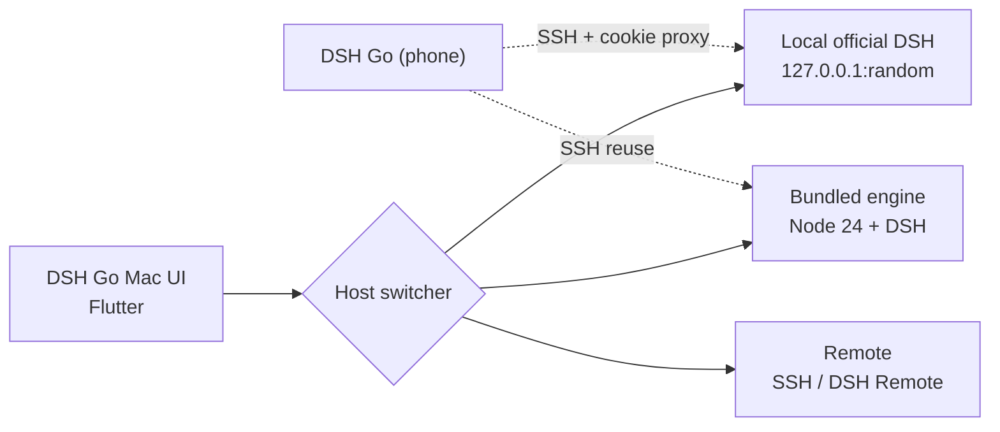

<div align="center">


<h3>One DSH engine. A more modern, more fluid macOS client.</h3>

<p><b>Detailed run context · smooth UX · modern motion</b><br/>
Attach to your existing official DSH without migrating data — or run the bundled engine.</p>

<p>
  <a href="https://github.com/BillWGong/dsh-go-mac/releases/latest"></a>
  <a href="https://github.com/BillWGong/dsh-go-mac/releases"></a>
  <a href="LICENSE"></a>
  <a href="#-requirements"></a>
  <a href="https://github.com/BillWGong/dsh-go-mac/stargazers"></a>
</p>

<p><a href="https://github.com/BillWGong/dsh-go-mac/releases/latest"><b>Download</b></a> · <a href="https://www.bilibili.com/video/BV1njxJ6WE59/">Demo video</a> · <a href="docs/macos/README.md">Docs</a> · <a href="README.md">简体中文</a></p>

</div>


> [!NOTE]
> This is an unofficial community project, not affiliated with DeepSeek.  
> The UI comes from [ccch1mneyyy/dsh-go](https://github.com/ccch1mneyyy/dsh-go) (AGPL-3.0); the platform layer is rewritten in Swift. See [NOTICE](NOTICE).

---

## ✨ Why this client

The official Mac client is fine — engine, models and plugins are all there.  
DSH Go Mac replaces **the layer you stare at all day**.

|  | Official client | **DSH Go Mac** |
| :--- | :--- | :--- |
| **Engine** | Official DSH | Official DSH (attach) or bundled engine |
| **Data** | `~/.dsh` | Same data when attached — **no migration** |
| **Runs** | Message-centric | Time / steps / changed files; trace, diff, files, progress, context |
| **Approvals** | Basic | **Allow / deny from a system notification** |
| **UI** | Official web / Electron style | Native Flutter UI from DSH Go, full motion |
| **Hosts** | Single machine | Bundled / official / remote SSH / DSH Remote, one switcher |
| **Phone** | — | The Android DSH Go can **SSH back into the Mac engine** |

<div align="center">

**Not another engine — another way to drive the same one.**

</div>

---

## 🚀 Quick start

```bash
# 1. Download the DMG (Apple Silicon / macOS 12+)
open https://github.com/BillWGong/dsh-go-mac/releases/latest

# 2. Drag it into Applications, then open it:
open "/Applications/DSH Go Mac.app"
# If Gatekeeper blocks it: right-click → Open, or
xattr -dr com.apple.quarantine "/Applications/DSH Go Mac.app"
```

On first launch the app looks for a local official DSH:

- **Already using the official client?** Pick “Connect to official DSH” — no migration, no runtime install.
- **Want the bundled engine?** Pick “This Mac” and install the ~750 MB runtime.
- **Remote?** Pick “Remote host”, then SSH or DSH Remote.

---

## 📸 Screenshots

<div align="center">

| Connect to official DSH (first run) | New chat |
| :---: | :---: |
|  |  |

[▶ Watch the demo](https://www.bilibili.com/video/BV1njxJ6WE59/)

</div>

---

## 🧩 Features

|  |  |
| :--- | :--- |
| **Run context** time / steps / changed files; trace, diff, files, progress, context | **Approvals** allow / deny straight from a notification; tap to jump back |
| **Thinking preview** fixed height, tap the body to collapse; finished turns fold away | **Commands** slash completion at the cursor without losing the draft |
| **Tables & code** three table tints, syntax highlighting, Mermaid, math | **Sessions** permanent delete (long-press / multi-select), archive restore, new chat in a folder |
| **Share card** export as an image with two QR codes (original + this port) | **Hosts** bundled / official / remote, one switcher with a clear source |
| **Native** notifications, files, PDF, speech, desktop pet, deep links, dark mode | **Window** adaptive ⇄ portrait layout (`⌘⇧M`), merged title bar |
| **Phone link** IP / user / port / password guidance right in the app | **Privacy** official mode never rewrites official data; secrets stay local |

---

## 🌐 Three host modes

| Mode | What it does | Runtime needed |
| :--- | :--- | :---: |
| **Local · bundled** | Node 24 + DSH inside the app; one-click install | ✅ |
| **Local · official** | Attach to the running DeepSeek Harness; shared chats / models / plugins | ❌ |
| **Remote** | SSH (password / key, TOFU fingerprint) or DSH Remote | ❌ |

> [!TIP]
> Official DSH and the bundled engine keep separate data: official uses `~/.dsh`, the bundled engine uses the app's own `Application Support` directory. Switching never mixes them.

---

## 📱 Phone → Mac

1. **Mac**: enable `System Settings › General › Sharing › Remote Login`
2. **App**: open `Settings › Local engine › Phone link` (or the switcher's “Phone link”):
   - Host: `user@LAN-IP`
   - Port: `22`
   - Password: **your Mac login password** (not a DeepSeek key)
3. **DSH Go on the phone**: `Switch host › Add SSH host`, enter the details, keep the default `dsh web` command
4. After connecting:
   - Bundled mode: the phone drives the Mac's bundled engine
   - Official mode: the phone drives the same official DSH (local cookie-injecting proxy, HTTP + WebSocket)

---

## 🏗 Architecture



<details>
<summary><b>How the bundled engine runs</b></summary>

- Runtime: Node 24 + `@deepseek-ai/dsh` + pnpm + `dsh-go-bridge`
- Launch: `node bin.js web --patch … --host 127.0.0.1 --port <free> --no-open`
- Parse `dsh web: http://…?token=` from stdout, log in with `DshClient`
- `manifest.json` carries the version, sha256 and launch argv; the tar unpacks into Application Support
- Process supervision, health checks, orphan reaping, safe mode
</details>

<details>
<summary><b>How official DSH attach works</b></summary>

- `lsof` finds the official process listening on `127.0.0.1:<port>`
- Read the `client-connection/browser-session` secret from `~/.dsh/.credentials.yaml`
- Mint a `DshCookie` locally (HMAC-SHA256, bound to the authority) and `DshClient.connect(cookie:)`
- Official data is never modified; switch back and forth at any time
</details>

<details>
<summary><b>The phone proxy (official mode)</b></summary>

The official server only accepts cookies; the phone only knows `dsh web` tokens. The app runs a loopback reverse proxy:

- Answers the phone's login with a local 303 + cookie
- Forwards HTTP / WebSocket to the official port, injecting the official cookie and rewriting Host
- Writes the handshake into `~/.dsh-app-remote` for the phone's existing protocol
</details>

---

## ⌨️ Shortcuts

| Keys | Action |
| :--- | :--- |
| <kbd>⌘</kbd> <kbd>⇧</kbd> <kbd>M</kbd> | Toggle adaptive / portrait layout |
| <kbd>Return</kbd> | Send if enabled in settings (off by default) |
| <kbd>Shift</kbd> + <kbd>Return</kbd> | New line |
| <kbd>⌘</kbd> / <kbd>Ctrl</kbd> + <kbd>Return</kbd> | Always send |
| <kbd>Esc</kbd> <kbd>Esc</kbd> | Stop the current turn (twice within 500 ms) |
| <kbd>⌘</kbd> <kbd>C</kbd> / <kbd>V</kbd> / <kbd>A</kbd> | Copy / paste / select all |

---

## 📦 Requirements

- Apple Silicon (arm64)
- macOS 12 or newer (developed on macOS 26 / 27)
- ~750 MB disk for the bundled engine; not needed for official-only use

---

## 🛠 Build from source

<details>
<summary><b>Expand build steps</b></summary>

Prerequisites:

1. Full Xcode; accept the licence once:
   ```bash
   sudo xcode-select -s /Applications/Xcode.app/Contents/Developer
   sudo xcodebuild -license accept
   ```
2. Flutter 3.47.x (Dart 3.13.5) on `PATH`, or pass `FLUTTER=`
3. ~8 GB free disk

```bash
git clone https://github.com/BillWGong/dsh-go-mac.git
cd dsh-go-mac

bash runtime/build-runtime-macos.sh   # build the bundled runtime (~2–5 min, 193 MB)
bash tooling/build-macos.sh --dmg     # produce .app and DMG
```

Artifacts:

```
app/build/macos/Build/Products/Release/dsh_go.app
app/build/macos/dsh-go-mac-1.0.17-macos-arm64.dmg
```

Environment check: `bash tooling/check-macos-env.sh`.
</details>

<details>
<summary><b>Tests</b></summary>

```bash
cd app
flutter analyze
flutter test test/macos           # macOS platform layer
flutter test test/chat test/state # shared UI / state
```
</details>

---

## ❓ FAQ

<details>
<summary><b>How does this relate to the official client?</b></summary>

Another client for the same engine. When attached, chats, models and plugins are shared; no data migration.
</details>

<details>
<summary><b>Why 255 MB app + 750 MB runtime?</b></summary>

The app ships Node + DSH as a 193 MB archive; the first bundled-engine run unpacks it (~750 MB). Official-only use skips it.
</details>

<details>
<summary><b>Unsigned / won't open?</b></summary>

Right-click → Open, or run `xattr -dr com.apple.quarantine "/Applications/DSH Go Mac.app"`. No Apple signing or notarization yet.
</details>

<details>
<summary><b>Saving an SSH host fails?</b></summary>

Since 1.0.16, remote secrets on macOS live in a 0600 file (`~/Library/Application Support/io.github.billwgong.dshgomac/remote-secrets.json`) instead of the Keychain. Ad-hoc signing has no Keychain entitlement; this is intentional.
</details>

<details>
<summary><b>Where did “delete conversation” go?</b></summary>

Permanent delete needs the bundled runtime `macos-r2`. Existing installs should reinstall the runtime from `Settings › Local engine` (keep conversations when prompted). Official mode does not support deletion.
</details>

<details>
<summary><b>The phone can't connect?</b></summary>

Check Remote Login, that the app is running, and that the phone uses the Mac's LAN IP + login password. Official mode also needs the app attached to the official DSH.
</details>

<details>
<summary><b>Intel Mac / Windows?</b></summary>

Apple Silicon only; Windows is not planned.
</details>

---

## 🗺 Roadmap

| Status | Item |
| :---: | :--- |
| ✅ | Bundled engine, official DSH attach, remote SSH / DSH Remote |
| ✅ | Notification approvals, files / PDF / speech, desktop pet |
| ✅ | Phone link (bundled + official) |
| ✅ | Permanent delete, archive restore, share card with two QR codes |
| 🚧 | Mac control (AX + ScreenCaptureKit + MCP tools + per-action approval) · [design](docs/macos/mac-control.md) |
| 🚧 | In-app update (DMG download and replace) |
| 🚧 | Signing / notarization |

---

## 📝 Changelog

<details>
<summary><b>1.0.17 → 1.0.10</b></summary>

**1.0.17** — synced upstream 1.0.8 shared UI: thinking preview, turn folding, dsh-ui free-form answers, media settings, plugin settings, credential affinity, update source fix, drawer performance

**1.0.16** — fixed #5 SSH host save (Keychain -34018) and #6 file permission page

**1.0.15** — synced 25 upstream commits: permanent delete, archive restore, new chat in a folder, table tints, plugin entries, slash completion, model names / token units

**1.0.14** — phone link for official mode (local cookie-injecting proxy)

**1.0.11** — fixed new chat failing (`/root/workspace` → `$HOME`)

**1.0.10** — merged title bar, portrait layout, share card QR codes, macOS copy

Full history: [Releases](https://github.com/BillWGong/dsh-go-mac/releases).
</details>

---

## 🤝 Contributing

- Bugs / feature requests: [Issues](https://github.com/BillWGong/dsh-go-mac/issues)
- Code: fork → branch → PR; run `flutter analyze` and the relevant tests first
- Upstream DSH Go issues belong in [ccch1mneyyy/dsh-go](https://github.com/ccch1mneyyy/dsh-go)
- Design and port notes: [docs/macos/README.md](docs/macos/README.md) · [Mac control design](docs/macos/mac-control.md)

---

## 📄 License

- This project: [AGPL-3.0](LICENSE)
- Upstream DSH Go: AGPL-3.0, [ccch1mneyyy/dsh-go](https://github.com/ccch1mneyyy/dsh-go)
- DeepSeek Harness: [deepseek-ai/deepseek-harness](https://github.com/deepseek-ai/deepseek-harness)
- Brand assets: see [NOTICE](NOTICE) and [ASSETS.md](ASSETS.md)

<div align="center">

**If it saves you from installing Linux, a star is the best support ⭐**

[](https://github.com/BillWGong/dsh-go-mac)

<sub>Built with Flutter + Swift · Not affiliated with DeepSeek</sub>

</div>
