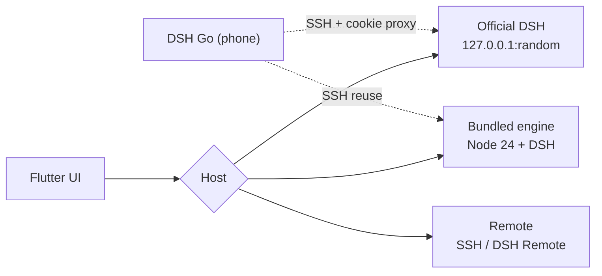

<div align="center">

<p><sub>DSH GO MAC · macOS</sub></p>

<h3>A second macOS client for DeepSeek Harness.<br/>One that shows you the work.</h3>

<p>It doesn't replace your engine. It puts what the agent is actually doing in front of you.</p>

<p>
  <a href="https://github.com/BillWGong/dsh-go-mac/releases/latest"></a>
  <a href="LICENSE"></a>
  <a href="https://github.com/BillWGong/dsh-go-mac/stargazers"></a>
</p>

<p><a href="https://github.com/BillWGong/dsh-go-mac/releases/latest"><b>Download</b></a> · <a href="https://www.bilibili.com/video/BV1njxJ6WE59/">Demo video</a> · <a href="README.md">简体中文</a></p>

</div>


> [!NOTE]
> Unofficial community project, not affiliated with DeepSeek. The UI comes from [ccch1mneyyy/dsh-go](https://github.com/ccch1mneyyy/dsh-go) (AGPL-3.0); the platform layer is written in Swift. See [NOTICE](NOTICE).

---

## Why this exists

The official client is fine. The engine, models and plugins are all there. Work gets done.

But what I actually watch all day is **where a run is**: what step just happened, which files changed, how long it took, why it stopped to ask me. That information lives in the chat stream — you scroll back, open things, and piece it together.

DSH Go Mac rebuilds that layer. **The run is the interface.** Chat is just how you get to it.

---

## Three things you'll notice

### 1. The whole run, at a glance

<p align="center"></p>

When a turn ends, the right panel gives you three numbers: **time, steps, changed files**.

Below them, five tabs: **trace, diff, files, progress, context**.

Diff opens the actual patch. Trace replays every step. Each thought and tool call gets its own row with its own timing. Approvals and questions rise out of the message stream instead of hiding below message forty.

### 2. The same engine. No migration.


On first launch it looks for a running DeepSeek Harness on your Mac. Pick “Connect to official DSH” and:

- Your chats, models and plugins are already there — **nothing is migrated or copied**
- It reads the same `~/.dsh`; the official client keeps working
- You can switch to the bundled engine, or to a remote host over SSH / DSH Remote

The two engines keep separate data. Switching never mixes them, and never rewrites the other.

### 3. Native, not a web wrapper

Flutter for the UI, Swift for the platform, native Node for the engine — no Electron, no embedded browser.

Notifications, files, PDF, speech, the desktop pet, windows and deep links all use macOS APIs. The motion is the mobile app's: breathing thinking pill, tool rows sliding in, continuous fold animations. That's not decoration — it's how you read a long run at a glance.

---

## Features, kept short

| What you'll use | What it does |
| :--- | :--- |
| **Runs & approvals** | Trace, diff, per-step timing; allow / deny from a notification |
| **Three hosts** | Official attach / bundled engine / remote SSH & DSH Remote |
| **Sessions** | Permanent delete, archive restore, new chat in a folder, slash completion |
| **Sharing** | Export a conversation as an image with two QR codes |
| **Phone** | The Android DSH Go can SSH back into the Mac engine |
| **Native** | Notifications, files, PDF, speech, pet, dark mode, portrait layout |

---

## Install

```bash
# 1. Download (Apple Silicon / macOS 12+)
open https://github.com/BillWGong/dsh-go-mac/releases/latest

# 2. Drag it into Applications, then open it
open "/Applications/DSH Go Mac.app"

# 3. If Gatekeeper blocks the unsigned build
xattr -dr com.apple.quarantine "/Applications/DSH Go Mac.app"
```

First launch:

- **Already using the official DSH?** Pick “Connect to official DSH” — no runtime install
- **Want the bundled engine?** Pick “This Mac” and install the ~750 MB runtime
- **Remote?** Pick “Remote host”

---

## Phone → Mac

1. On the Mac, enable `System Settings › General › Sharing › Remote Login`
2. In the app, open `Settings › Local engine › Phone link` — host, port and the password note are right there
3. In DSH Go on the phone: `Switch host › Add SSH host`, keep the default `dsh web` command
4. The password is **your Mac login password**, not a DeepSeek key

In official mode the phone attaches to the same official DSH through a local cookie-injecting proxy (HTTP + WebSocket).

---

## How it's built



<details>
<summary><b>Bundled engine</b></summary>

Node 24 + `@deepseek-ai/dsh` + pnpm + `dsh-go-bridge`, packed into a 193 MB tar with a `manifest.json` (version, sha256, launch argv). It unpacks into Application Support and starts with `node bin.js web --host 127.0.0.1 --port <free> --no-open`; the token is read from stdout. Process supervision, health checks, orphan reaping, safe mode.
</details>

<details>
<summary><b>Official DSH attach</b></summary>

`lsof` finds the official listening port, the browser-session secret is read from `~/.dsh/.credentials.yaml`, and a `DshCookie` is minted locally (HMAC-SHA256, bound to the authority) before connecting. Official data is never written.
</details>

<details>
<summary><b>Phone proxy</b></summary>

The official server only accepts cookies; the phone only knows `dsh web` tokens. The app runs a loopback reverse proxy: the phone's login gets a 303 + local cookie, HTTP/WebSocket is forwarded to the official port with the official cookie injected and Host rewritten; the handshake lands in `~/.dsh-app-remote`.
</details>

---

## Status

| | |
| :--- | :--- |
| ✅ Working | Bundled engine, official attach, remote, notification approvals, files/PDF/speech, pet, phone link, share card |
| 🚧 Not yet | Mac control (AX + ScreenCaptureKit + MCP, [design](docs/macos/mac-control.md)), in-app updates, signing/notarization |
| ❌ Not supported | Intel Mac, Windows |

---

## FAQ

<details>
<summary><b>How is this related to the official client?</b></summary>

Another client for the same engine. When attached, chats, models and plugins are shared; no data migration.
</details>

<details>
<summary><b>Why 255 MB, and another 750 MB?</b></summary>

The app ships a 193 MB compressed Node + DSH runtime. The first bundled-engine run unpacks it. Official-only use skips it entirely.
</details>

<details>
<summary><b>Unsigned / won't open?</b></summary>

Right-click → Open, or `xattr -dr com.apple.quarantine "/Applications/DSH Go Mac.app"`. No signing or notarization yet.
</details>

<details>
<summary><b>Saving an SSH host fails?</b></summary>

Since 1.0.16, remote secrets use a 0600 file (ad-hoc signing has no Keychain entitlement) at `~/Library/Application Support/io.github.billwgong.dshgomac/remote-secrets.json`.
</details>

<details>
<summary><b>Where did “delete conversation” go?</b></summary>

It needs the bundled runtime `macos-r2`. Existing installs should reinstall the runtime from `Settings › Local engine` (keep conversations when prompted). Official mode does not support deletion.
</details>

---

## Development

```bash
git clone https://github.com/BillWGong/dsh-go-mac.git
cd dsh-go-mac
bash runtime/build-runtime-macos.sh   # bundled runtime
bash tooling/build-macos.sh --dmg     # .app + DMG
```

```bash
cd app
flutter analyze
flutter test test/macos
flutter test test/chat test/state
```

Full Xcode, Flutter 3.47.x, Apple Silicon, ~8 GB free disk. Environment check: `bash tooling/check-macos-env.sh`.

---

## License & credits

AGPL-3.0. Built on [ccch1mneyyy/dsh-go](https://github.com/ccch1mneyyy/dsh-go); the engine is [DeepSeek Harness](https://github.com/deepseek-ai/deepseek-harness). Brand attribution in [NOTICE](NOTICE) and [ASSETS.md](ASSETS.md).

<div align="center">

**If it saves you from scrolling through chat logs, a star is enough ⭐**

[](https://github.com/BillWGong/dsh-go-mac)

</div>
