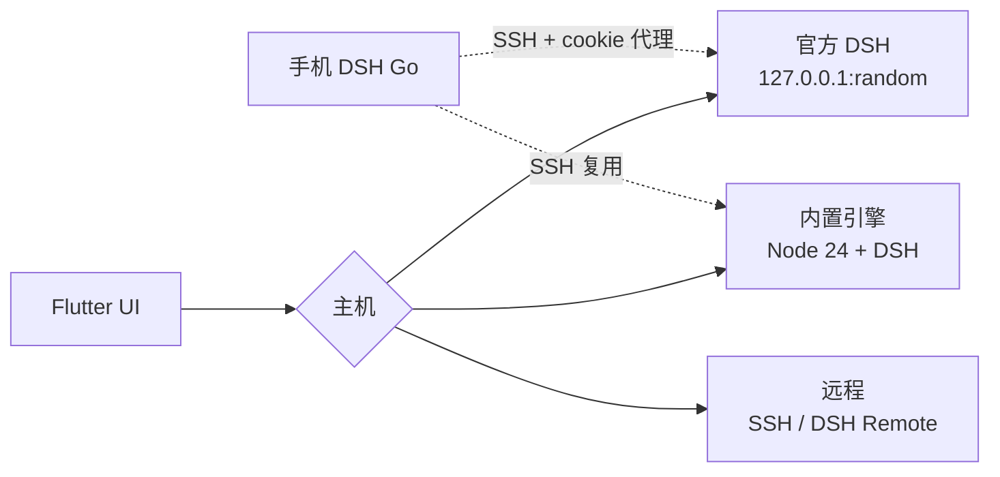

<div align="center">

<p><sub>DSH GO MAC · macOS</sub></p>

<h3>同一个 DSH 引擎，<br/>一个更愿意天天打开的客户端。</h3>

<p>它不替换你的引擎，只把「代理正在做什么」摆到你面前。</p>

<p>
  <a href="https://github.com/BillWGong/dsh-go-mac/releases/latest"></a>
  <a href="LICENSE"></a>
  <a href="https://github.com/BillWGong/dsh-go-mac/stargazers"></a>
</p>

<p><a href="https://github.com/BillWGong/dsh-go-mac/releases/latest"><b>下载</b></a> · <a href="https://www.bilibili.com/video/BV1njxJ6WE59/">演示视频</a> · <a href="README.en.md">English</a></p>

</div>


> [!NOTE]
> 非官方社区项目，与 DeepSeek 无隶属关系。界面来自 [ccch1mneyyy/dsh-go](https://github.com/ccch1mneyyy/dsh-go)（AGPL-3.0），平台层以 Swift 重写。归属见 [NOTICE](NOTICE)。

---

## 为什么做这个

官方客户端没问题。引擎、模型、插件都在，活能干。

但我每天真正盯着的是**一轮任务跑到哪了**：刚才那步在干什么、改了哪些文件、花了多久、为什么停下来等我。这些信息在聊天流里，得往上翻、点开、再拼起来。

DSH Go Mac 把这层重做了：**运行过程是一等公民**，聊天只是它的入口。

---

## 你会看到的三件事

### 1. 一轮任务的全貌

<p align="center"></p>

一轮任务结束时，右边直接给你三个数：**用时、步骤、改动文件**。

下面五个页签：**轨迹 / 改动 / 文件 / 进度 / 上下文**。

点「改动」就是 diff；点「轨迹」回看每一步；每一条思考、工具调用、耗时都独立成行。需要你决策的审批和提问从消息流里浮出来，不藏在第 40 条消息后面。

### 2. 同一个引擎，零迁移


首次启动会检测本机正在运行的 DeepSeek Harness。点「连接官方 DSH」：

- 对话、模型、插件原样都在，**不迁移、不复制**
- 读的还是 `~/.dsh`，官方客户端随时可以继续用
- 也可以切到 App 内置引擎，或远程 SSH / DSH Remote

两个引擎是两套数据。切换主机不会混，也不会改对方。

### 3. 原生，不是套壳

界面是 Flutter，平台层是 Swift，本机引擎是原生 Node——没有 Electron，没有内嵌浏览器。

通知、文件、PDF、语音、桌宠、窗口、深链都走 macOS 原生 API。动效是移动端那套：思考胶囊呼吸、工具行滑入、折叠连续展开。这些不是装饰，是让你在长任务里**扫一眼就知道状态**。

---

## 功能，克制地列

| 你会用到的 | 说明 |
| :--- | :--- |
| **过程与审批** | 轨迹、diff、步骤耗时；通知上直接允许 / 拒绝 |
| **三种主机** | 官方直连 / 内置引擎 / 远程 SSH、DSH Remote |
| **会话管理** | 永久删除、归档恢复、文件夹新建、slash 补全 |
| **分享** | 对话导出成图，带原作与本移植两个二维码 |
| **手机接管** | 手机版 DSH Go 通过 SSH 连回 Mac 的引擎 |
| **Mac 原生** | 通知、文件、PDF、语音、桌宠、深色模式、竖屏版式 |

---

## 安装

```bash
# 1. 下载（Apple Silicon / macOS 12+）
open https://github.com/BillWGong/dsh-go-mac/releases/latest

# 2. 拖进 Applications，首次打开
open "/Applications/DSH Go Mac.app"

# 3. 未签名构建被 Gatekeeper 拦住时
xattr -dr com.apple.quarantine "/Applications/DSH Go Mac.app"
```

首次启动：

- **已在用官方 DSH** → 选「连接官方 DSH · 推荐」，不装运行时
- **想用内置引擎** → 选「本机」，安装约 750 MB 运行时
- **连远程** → 选「远程主机」

---

## 手机连接 Mac

1. Mac 打开 `系统设置 › 通用 › 共享 › 远程登录`
2. App 打开 `设置 › 本机引擎 › 手机连接`，页面上有主机、端口和密码说明
3. 手机版 DSH Go：`切换主机 › 添加 SSH 主机`，启动命令保持 `dsh web`
4. 密码就是**这台 Mac 的登录密码**，不是 DeepSeek Key

官方模式下，手机连的是同一个官方 DSH（本地 cookie 注入代理，HTTP + WebSocket）。

---

## 它是怎么搭的



<details>
<summary><b>内置引擎</b></summary>

Node 24 + `@deepseek-ai/dsh` + pnpm + `dsh-go-bridge`，打包成 193 MB tar，带 `manifest.json`（版本、sha256、启动 argv）。解包到 Application Support，`node bin.js web --host 127.0.0.1 --port <free> --no-open` 启动，从 stdout 拿 token 登录。进程监督、健康检查、孤儿回收、安全模式。
</details>

<details>
<summary><b>官方 DSH 直连</b></summary>

`lsof` 找官方监听端口，读 `~/.dsh/.credentials.yaml` 的 browser-session 密钥，本地签 `DshCookie`（HMAC-SHA256，authority 绑定）后连上去。不写官方数据。
</details>

<details>
<summary><b>手机代理</b></summary>

官方只认 cookie，手机只认 `dsh web` token。App 在 127.0.0.1 起反向代理：手机登录返回 303 + 本地 cookie，HTTP/WebSocket 转发到官方端口并注入官方 cookie、重写 Host；握手写进 `~/.dsh-app-remote`。
</details>

---

## 状态

| | |
| :--- | :--- |
| ✅ 可用 | 本机引擎、官方直连、远程、通知审批、文件/PDF/语音、桌宠、手机连接、分享卡 |
| 🚧 未完成 | Mac 操控（AX + ScreenCaptureKit + MCP，[设计稿](docs/macos/mac-control.md)）、应用内更新、签名/公证 |
| ❌ 不支持 | Intel Mac、Windows |

---

## FAQ

<details>
<summary><b>和官方客户端是什么关系？</b></summary>

同一个引擎的另一个客户端。连官方时共用对话、模型和插件，不迁移数据。
</details>

<details>
<summary><b>为什么 App 255 MB，还要 750 MB？</b></summary>

App 自带 193 MB 压缩的 Node + DSH 运行时；首次用内置引擎才解包。只用官方模式可以不装。
</details>

<details>
<summary><b>未签名 / 打不开？</b></summary>

右键 →「打开」，或 `xattr -dr com.apple.quarantine "/Applications/DSH Go Mac.app"`。暂无签名与公证。
</details>

<details>
<summary><b>SSH 主机保存失败？</b></summary>

1.0.16 起远程密钥改用 0600 文件存储（ad-hoc 签名没有 Keychain entitlement），路径在 `~/Library/Application Support/io.github.billwgong.dshgomac/remote-secrets.json`。
</details>

<details>
<summary><b>删除对话入口不见了？</b></summary>

需要内置运行时 `macos-r2`。老用户在 `设置 › 本机引擎` 重新安装一次运行时（可保留对话）；官方模式不支持删除。
</details>

---

## 开发

```bash
git clone https://github.com/BillWGong/dsh-go-mac.git
cd dsh-go-mac
bash runtime/build-runtime-macos.sh   # 内置运行时
bash tooling/build-macos.sh --dmg     # .app + DMG
```

```bash
cd app
flutter analyze
flutter test test/macos
flutter test test/chat test/state
```

需要完整 Xcode、Flutter 3.47.x、Apple Silicon、约 8 GB 磁盘。环境检查：`bash tooling/check-macos-env.sh`。

---

## 许可与致谢

AGPL-3.0。基于 [ccch1mneyyy/dsh-go](https://github.com/ccch1mneyyy/dsh-go)，引擎是 [DeepSeek Harness](https://github.com/deepseek-ai/deepseek-harness)。品牌归属见 [NOTICE](NOTICE) 与 [ASSETS.md](ASSETS.md)。

<div align="center">

**如果它让你少翻几次聊天记录，点个 star 就够了 ⭐**

[](https://github.com/BillWGong/dsh-go-mac)

</div>
