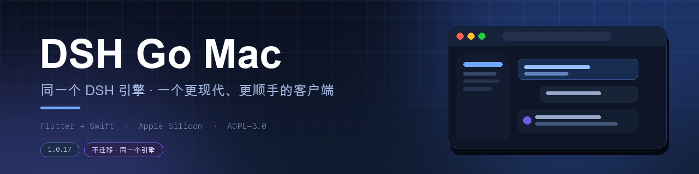
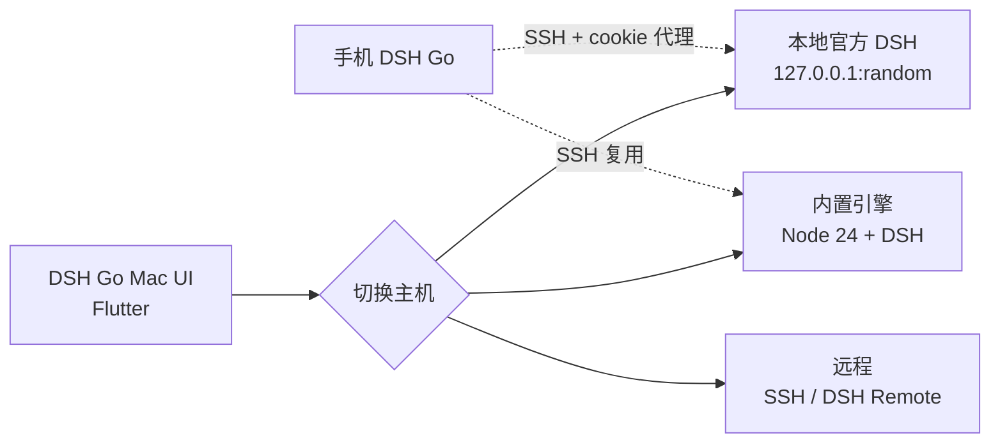

<div align="center">



<h3>同一个 DSH 引擎，一个更现代、更顺手的 macOS 客户端</h3>

<p><b>过程信息 · 流畅交互 · 现代动效</b><br/>
连你现有的官方 DSH，不迁移数据；也可以直接用 App 内置引擎。</p>

<p>
  <a href="https://github.com/BillWGong/dsh-go-mac/releases/latest"></a>
  <a href="https://github.com/BillWGong/dsh-go-mac/releases"></a>
  <a href="LICENSE"></a>
  <a href="#-系统要求"></a>
  <a href="https://github.com/BillWGong/dsh-go-mac/stargazers"></a>
</p>

<p><a href="https://github.com/BillWGong/dsh-go-mac/releases/latest"><b>下载</b></a> · <a href="https://www.bilibili.com/video/BV1njxJ6WE59/">演示视频</a> · <a href="docs/macos/README.md">文档</a> · <a href="README.en.md">English</a></p>

</div>


> [!NOTE]
> 非官方社区项目，与 DeepSeek 无隶属关系。界面来自 [ccch1mneyyy/dsh-go](https://github.com/ccch1mneyyy/dsh-go)（AGPL-3.0），平台层以 Swift 重写；归属说明见 [NOTICE](NOTICE)。

---

## ✨ 为什么是它

官方 Mac 客户端没问题，引擎、模型、插件都在。  
DSH Go Mac 换的是**你每天盯着的那一层**。

|  | 官方客户端 | **DSH Go Mac** |
| :--- | :--- | :--- |
| **引擎** | 官方 DSH | 官方 DSH（直连）或内置引擎 |
| **数据** | `~/.dsh` | 连官方时就是同一份，**不迁移** |
| **过程** | 以消息为主 | 用时 / 步骤 / 改动文件；轨迹、改动、文件、进度、上下文 |
| **审批** | 基础 | 系统通知上直接**允许 / 拒绝** |
| **界面** | 官方 Web / Electron 风格 | DSH Go 原生 Flutter，动效完整 |
| **主机** | 单机 | 自带 / 官方 / 远程 SSH / DSH Remote，一键切换 |
| **手机** | — | 手机版 DSH Go 可通过 SSH **连回 Mac 的引擎** |

<div align="center">

**不是另一个引擎，是同一个引擎的另一种打开方式。**

</div>

---

## 🚀 30 秒上手

```bash
# 1. 下载 DMG（Apple Silicon / macOS 12+）
open https://github.com/BillWGong/dsh-go-mac/releases/latest

# 2. 拖进 Applications，首次打开：
open "/Applications/DSH Go Mac.app"
# 被 Gatekeeper 拦住时：右键 →「打开」，或
xattr -dr com.apple.quarantine "/Applications/DSH Go Mac.app"
```

首次启动会自动检测本机官方 DSH：

- **已经在用官方 DSH** → 选「连接官方 DSH · 推荐」，不迁移、不装运行时
- **想用内置引擎** → 选「本机」，安装约 750 MB 运行时
- **连远程** → 选「远程主机」，SSH 或 DSH Remote

---

## 📸 截图

<div align="center">

| 连接官方 DSH（首次引导） | 新对话 |
| :---: | :---: |
|  |  |

[▶ 观看演示视频](https://www.bilibili.com/video/BV1njxJ6WE59/)

</div>

---

## 🧩 功能

|  |  |
| :--- | :--- |
| **过程信息** 用时 / 步骤 / 改动文件；轨迹、改动、文件、进度、上下文；点开就是 diff | **审批与提问** 系统通知上直接允许 / 拒绝，点通知回到对话 |
| **思考预览** 固定高度，点正文收起；完成的回合自动折叠 | **命令与草稿** slash 在光标处补全，不丢草稿 |
| **表格与代码** 三档表格底色、代码高亮、Mermaid、公式 | **会话管理** 永久删除（长按 / 多选）、归档恢复、文件夹新建 |
| **分享卡** 导出图片，带原作与本移植两个二维码 | **多主机** 自带 / 官方 / 远程，一个弹层切换，来源清晰 |
| **原生能力** 通知、文件、PDF、语音、桌宠、深链、深色模式 | **窗口** 自适应 ⇄ 竖屏版式（`⌘⇧M`），顶栏与标题栏合并 |
| **手机连接** App 内列出 IP / 用户名 / 端口 / 密码说明 | **隐私** 官方模式不改官方数据；密钥只保存在本机 |

---

## 🌐 三种主机

| 模式 | 说明 | 需要运行时 |
| :--- | :--- | :---: |
| **本地 DSH · 自带** | App 内置 Node 24 + DSH，一键安装 | ✅ |
| **本地官方 DSH** | 直连这台 Mac 上运行中的 DeepSeek Harness，共享对话 / 模型 / 插件 | ❌ |
| **远程** | SSH（密码 / 私钥，TOFU 指纹）或 DSH Remote | ❌ |

> [!TIP]
> 官方 DSH 与内置引擎是两套数据：官方用 `~/.dsh`，内置引擎用 App 自己的 `Application Support` 目录。切换主机不会混淆，也不会改对方的数据。

---

## 📱 手机连接 Mac

1. **Mac**：`系统设置 › 通用 › 共享 › 远程登录` 打开
2. **App**：`设置 › 本机引擎 › 手机连接`（或切换主机里的「手机连接」）查看：
   - 主机：`用户名@局域网 IP`
   - 端口：`22`
   - 密码：**这台 Mac 的登录密码**（不是 DeepSeek Key）
3. **手机版 DSH Go**：`切换主机 › 添加 SSH 主机`，填写上述信息，启动命令保持默认 `dsh web`
4. 连上后：
   - 自带模式：手机接管 Mac 的内置引擎
   - 官方模式：手机接管同一个官方 DSH（本地 cookie 注入代理，HTTP + WebSocket）

---

## 🏗 架构



<details>
<summary><b>本机引擎怎么跑</b></summary>

- 运行时：Node 24 + `@deepseek-ai/dsh` + pnpm + `dsh-go-bridge`
- 启动：`node bin.js web --patch … --host 127.0.0.1 --port <free> --no-open`
- 从 stdout 解析 `dsh web: http://…?token=`，用 `DshClient` 登录
- `manifest.json` 描述版本、sha256、启动 argv；tar 解包到 Application Support
- 进程监督、健康检查、孤儿进程回收、安全模式
</details>

<details>
<summary><b>官方 DSH 直连怎么工作</b></summary>

- `lsof` 找到官方进程监听的 `127.0.0.1:<port>`
- 读 `~/.dsh/.credentials.yaml` 的 `client-connection/browser-session` 密钥
- 本地签 `DshCookie`（HMAC-SHA256，authority 绑定），`DshClient.connect(cookie:)`
- 不修改官方数据；官方模式与内置引擎随时切换
</details>

<details>
<summary><b>手机代理（官方模式）</b></summary>

官方服务只认 cookie，手机只认 `dsh web` 的 token。App 在 `127.0.0.1` 起反向代理：

- 手机登录时返回本地 303 + cookie
- HTTP / WebSocket 转发到官方端口，注入官方 cookie、重写 Host
- 握手文件写入 `~/.dsh-app-remote`，手机按原协议复用
</details>

---

## ⌨️ 快捷键

| 按键 | 作用 |
| :--- | :--- |
| <kbd>⌘</kbd> <kbd>⇧</kbd> <kbd>M</kbd> | 自适应 / 竖屏版式切换 |
| <kbd>Return</kbd> | 按设置决定是否发送（默认关闭） |
| <kbd>Shift</kbd> + <kbd>Return</kbd> | 换行 |
| <kbd>⌘</kbd> / <kbd>Ctrl</kbd> + <kbd>Return</kbd> | 始终发送 |
| <kbd>Esc</kbd> <kbd>Esc</kbd> | 停止当前回合（500 ms 内两次） |
| <kbd>⌘</kbd> <kbd>C</kbd> / <kbd>V</kbd> / <kbd>A</kbd> | 复制 / 粘贴 / 全选 |

---

## 📦 系统要求

- Apple Silicon（arm64）
- macOS 12 或更高（在 macOS 26 / 27 上开发验证）
- 内置引擎约 750 MB 磁盘；只用官方模式则不需要

---

## 🛠 从源码构建

<details>
<summary><b>展开构建步骤</b></summary>

前置：

1. 完整 Xcode，首次同意许可：
   ```bash
   sudo xcode-select -s /Applications/Xcode.app/Contents/Developer
   sudo xcodebuild -license accept
   ```
2. Flutter 3.47.x（Dart 3.13.5），在 `PATH` 中或用 `FLUTTER=` 指定
3. 约 8 GB 空闲磁盘

```bash
git clone https://github.com/BillWGong/dsh-go-mac.git
cd dsh-go-mac

bash runtime/build-runtime-macos.sh   # 生成内置运行时（约 2–5 分钟，193 MB）
bash tooling/build-macos.sh --dmg     # 产出 .app 与 DMG
```

产物：

```
app/build/macos/Build/Products/Release/dsh_go.app
app/build/macos/dsh-go-mac-1.0.17-macos-arm64.dmg
```

环境检查：`bash tooling/check-macos-env.sh`。
</details>

<details>
<summary><b>测试</b></summary>

```bash
cd app
flutter analyze
flutter test test/macos           # macOS 接入层
flutter test test/chat test/state # 共享 UI / 状态
```
</details>

---

## ❓ FAQ

<details>
<summary><b>和官方客户端是什么关系？</b></summary>

同一个引擎的另一个客户端。连官方时共用对话、模型和插件，不迁移数据。
</details>

<details>
<summary><b>为什么 App 有 255 MB，还要装 750 MB？</b></summary>

App 自带 Node + DSH 运行时（193 MB 压缩）；首次使用本机引擎才解包（约 750 MB）。只用官方模式可以不装。
</details>

<details>
<summary><b>未签名 / 打不开？</b></summary>

右键 →「打开」，或执行 `xattr -dr com.apple.quarantine "/Applications/DSH Go Mac.app"`。暂无 Apple 签名与公证。
</details>

<details>
<summary><b>保存 SSH 主机报错？</b></summary>

1.0.16 起 macOS 上远程密钥改用 0600 文件存储（`~/Library/Application Support/io.github.billwgong.dshgomac/remote-secrets.json`），不再依赖 Keychain。ad-hoc 签名没有 Keychain entitlement，这是有意为之。
</details>

<details>
<summary><b>删除对话的入口不见了？</b></summary>

永久删除需要内置运行时 `macos-r2`。老用户请在 `设置 › 本机引擎` 重新安装一次运行时（按提示保留对话）；官方模式不支持删除。
</details>

<details>
<summary><b>手机连不上？</b></summary>

确认远程登录已开、App 正在运行、手机填的是 Mac 的局域网 IP + 登录密码。官方模式还需要 App 已连上官方 DSH。
</details>

<details>
<summary><b>Intel Mac / Windows？</b></summary>

只支持 Apple Silicon；Windows 没有计划。
</details>

---

## 🗺 Roadmap

| 状态 | 项目 |
| :---: | :--- |
| ✅ | 本机引擎、官方 DSH 直连、远程 SSH / DSH Remote |
| ✅ | 系统通知审批、文件 / PDF / 语音、桌宠 |
| ✅ | 手机连接（自带 + 官方） |
| ✅ | 永久删除、归档恢复、分享卡双二维码 |
| 🚧 | Mac 操控（AX + ScreenCaptureKit + MCP 工具 + 逐次审批）· [设计稿](docs/macos/mac-control.md) |
| 🚧 | 应用内更新（DMG 下载与替换） |
| 🚧 | 签名 / 公证 |

---

## 📝 更新记录

<details>
<summary><b>1.0.17 → 1.0.10</b></summary>

**1.0.17**：跟进上游 1.0.8 共享 UI（思考预览、回合折叠、dsh-ui 自由回答、媒体设置页、插件设置、凭据归属、更新源修复、抽屉性能）

**1.0.16**：修复 #5 远程 SSH 保存（Keychain -34018）、#6 文件权限页

**1.0.15**：同步上游 25 个提交（永久删除、归档恢复、文件夹新建、表格底色、插件入口、slash 补全、模型卡 / token）

**1.0.14**：官方模式手机连接（本地 cookie 注入代理）

**1.0.11**：修复新建对话失败（`/root/workspace` → `$HOME`）

**1.0.10**：顶栏与标题栏合并、竖屏版式、分享卡双二维码、Mac 措辞

完整记录见 [Releases](https://github.com/BillWGong/dsh-go-mac/releases)。
</details>

---

## 🤝 参与

- 有 bug / 想加功能：[Issues](https://github.com/BillWGong/dsh-go-mac/issues)
- 想改代码：Fork → 分支 → PR；提交前跑 `flutter analyze` 和相关测试
- 上游 DSH Go 的问题请提到 [ccch1mneyyy/dsh-go](https://github.com/ccch1mneyyy/dsh-go)
- 设计与移植笔记：[docs/macos/README.md](docs/macos/README.md) · [Mac 操控设计](docs/macos/mac-control.md)

---

## 📄 许可

- 本项目：[AGPL-3.0](LICENSE)
- 上游 DSH Go：AGPL-3.0，[ccch1mneyyy/dsh-go](https://github.com/ccch1mneyyy/dsh-go)
- DeepSeek Harness：[deepseek-ai/deepseek-harness](https://github.com/deepseek-ai/deepseek-harness)
- 品牌与素材归属见 [NOTICE](NOTICE) 与 [ASSETS.md](ASSETS.md)

<div align="center">

**如果它帮你省掉了装 Linux 的麻烦，点个 star 就是最大的支持 ⭐**

[](https://github.com/BillWGong/dsh-go-mac)

<sub>Built with Flutter + Swift · Not affiliated with DeepSeek</sub>

</div>
