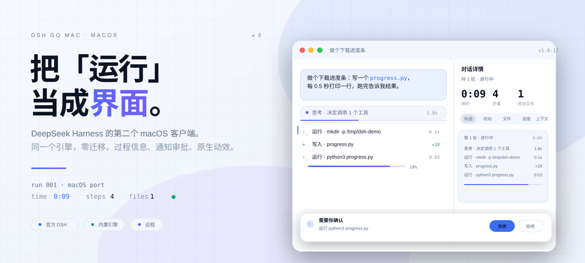
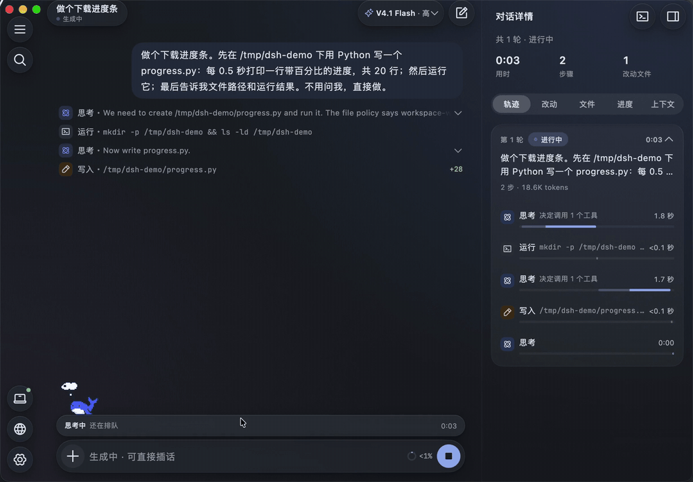
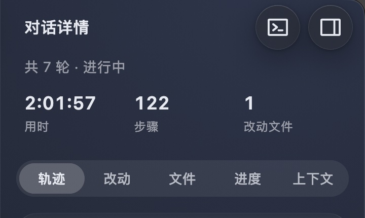
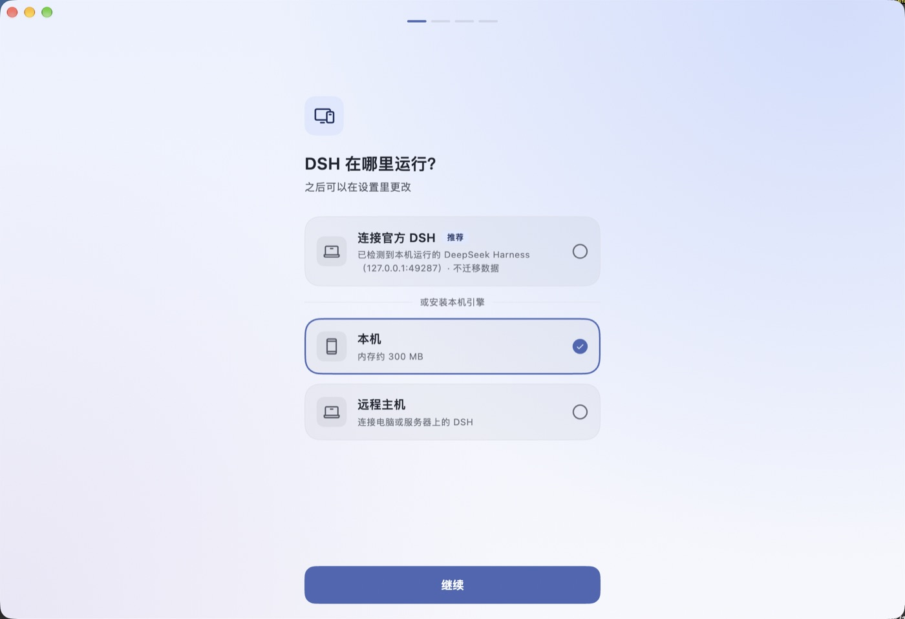
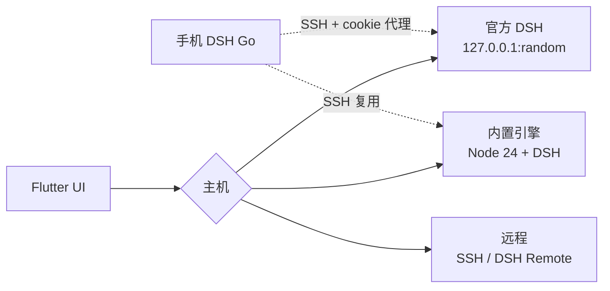

<div align="center">

<picture>
  <source media="(prefers-color-scheme: dark)" srcset="docs/images/hero-dark.svg">
  
</picture>

<p><a href="https://github.com/BillWGong/dsh-go-mac/releases/latest"><b>下载</b></a> · <a href="https://github.com/BillWGong/homebrew-tap">Homebrew</a> · <a href="https://www.bilibili.com/video/BV1njxJ6WE59/">演示视频</a> · <a href="https://billwgong.github.io/dsh-go-mac/">主页</a> · <a href="README.en.md">English</a></p>

<p><sub>macOS 12+ · Apple Silicon · AGPL-3.0</sub></p>

</div>

> [!NOTE]
> 非官方社区项目，与 DeepSeek 无隶属关系。界面来自 [ccch1mneyyy/dsh-go](https://github.com/ccch1mneyyy/dsh-go)（AGPL-3.0），平台层以 Swift 重写。归属见 [NOTICE](NOTICE)。

---

## 01 · 你从哪里来？

<details open>
<summary><b>已经在用官方 DSH</b> — 我只想换个界面</summary>

不用装运行时，也不用迁移。启动后选「连接官方 DSH」，读的是同一个 `~/.dsh`。

```bash
brew install --cask BillWGong/tap/dsh-go-mac
```

</details>

<details>
<summary><b>想让 Mac 自己跑</b> — 不依赖官方客户端</summary>

装内置运行时（约 750 MB），DSH 就跑在这台 Mac 上；也可以随时切回官方。

```bash
brew install --cask BillWGong/tap/dsh-go-mac
# 首次启动选「本机」，点安装运行时
```

</details>

<details>
<summary><b>想连远程</b> — SSH / DSH Remote</summary>

同一套 UI 连电脑或服务器上的 DSH。手机版 DSH Go 也可以反过来说接管这台 Mac。

```text
设置 › 切换主机 › 远程主机
```

</details>

## 02 · 十秒，没有加速

<p align="center"></p>

<p align="center"><sub>真实录屏。一个需要工具调用的任务，从思考到运行详情。</sub></p>

## 03 · 运行是界面

<p align="center"></p>

一轮任务结束，三个数先给你：**用时、步骤、改动文件**。下面五个页签：**轨迹 / 改动 / 文件 / 进度 / 上下文**。

点「改动」就是 diff；点「轨迹」回看每一步；每条思考、工具调用、耗时独立成行。需要你决策的审批和提问从消息流里浮出来，不藏在第 40 条消息后面。

## 04 · 同一个引擎，零迁移



首次启动检测本机正在运行的 DeepSeek Harness。点「连接官方 DSH」：

- 对话、模型、插件原样都在，**不迁移、不复制**
- 读的还是 `~/.dsh`，官方客户端随时可以继续用
- 也可以切到内置引擎，或远程 SSH / DSH Remote

两个引擎是两套数据。切换主机不会混，也不会改对方。

## 05 · 原生

界面是 Flutter，平台层是 Swift，本机引擎是原生 Node。

没有 Electron，没有内嵌浏览器。通知、文件、PDF、语音、桌宠、窗口、深链全部走 macOS API。通知上的「允许 / 拒绝」是真的系统通知，不是网页里的按钮。

## 06 · 它不是什么

- **不是新引擎。** 引擎还是 DSH；它只是另一个客户端。
- **不是官方客户端的替代。** 连官方时，两边可以同时用。
- **不是网页壳。** 没有内嵌浏览器。
- **不是给 Intel 的。** 运行时只做 arm64。
- **不是完成品。** Mac 操控、应用内更新、签名都还没做。

## 07 · 装上

```bash
# 一条命令
brew install --cask BillWGong/tap/dsh-go-mac

# 或者下载 DMG（Apple Silicon / macOS 12+）
open https://github.com/BillWGong/dsh-go-mac/releases/latest
open "/Applications/DSH Go Mac.app"

# 未签名构建被 Gatekeeper 拦住时
xattr -dr com.apple.quarantine "/Applications/DSH Go Mac.app"
```

## 08 · 现在到哪了

| | |
| :--- | :--- |
| ✅ 可以日常用 | 本机引擎、官方直连、远程、通知审批、文件/PDF/语音、桌宠、手机连接、分享卡 |
| 🚧 还没做 | Mac 操控（[设计稿](docs/macos/mac-control.md)）、应用内更新、签名/公证 |
| ❌ 不做 | Intel Mac、Windows |

---

<details>
<summary><b>它是怎么搭的</b></summary>



- **内置引擎**：Node 24 + DSH + pnpm + bridge，193 MB tar + manifest；解包到 Application Support，`node bin.js web --port <free>`，stdout 拿 token，进程监督与安全模式。
- **官方直连**：`lsof` 找端口，读 `~/.dsh` 的 browser-session 密钥，本地签 HMAC cookie，不写官方数据。
- **手机代理**：127.0.0.1 反向代理，手机拿本地 cookie，转发 HTTP/WebSocket 并注入官方 cookie、重写 Host。
</details>

<details>
<summary><b>开发与测试</b></summary>

```bash
git clone https://github.com/BillWGong/dsh-go-mac.git
cd dsh-go-mac
bash runtime/build-runtime-macos.sh   # 内置运行时
bash tooling/build-macos.sh --dmg     # .app + DMG

cd app
flutter analyze
flutter test test/macos
flutter test test/chat test/state
```

需要完整 Xcode、Flutter 3.47.x、Apple Silicon、约 8 GB 磁盘。环境检查：`bash tooling/check-macos-env.sh`。
</details>

<details>
<summary><b>常见问题</b></summary>

**和官方客户端是什么关系？** 同一个引擎的另一个客户端。连官方时共用对话、模型和插件，不迁移数据。

**为什么 App 255 MB，还要 750 MB？** App 自带 193 MB 压缩的 Node + DSH 运行时；首次用内置引擎才解包。只用官方模式可以不装。

**未签名 / 打不开？** 右键 →「打开」，或 `xattr -dr com.apple.quarantine "/Applications/DSH Go Mac.app"`。

**SSH 主机保存失败？** 1.0.16 起远程密钥改用 0600 文件存储（ad-hoc 签名没有 Keychain entitlement），路径在 `~/Library/Application Support/io.github.billwgong.dshgomac/remote-secrets.json`。

**删除对话入口不见了？** 需要内置运行时 `macos-r2`。老用户在 `设置 › 本机引擎` 重新安装一次运行时（可保留对话）；官方模式不支持删除。
</details>

---

## 许可

AGPL-3.0。基于 [ccch1mneyyy/dsh-go](https://github.com/ccch1mneyyy/dsh-go)，引擎是 [DeepSeek Harness](https://github.com/deepseek-ai/deepseek-harness)。品牌归属见 [NOTICE](NOTICE) 与 [ASSETS.md](ASSETS.md)。

<div align="center">

**如果它让你少翻几次聊天记录，点个 star 就够了 ⭐**

[](https://github.com/BillWGong/dsh-go-mac)

</div>
